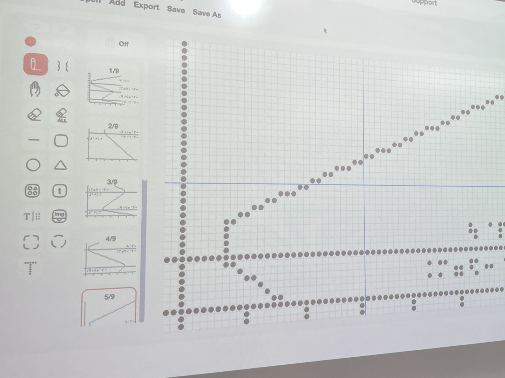
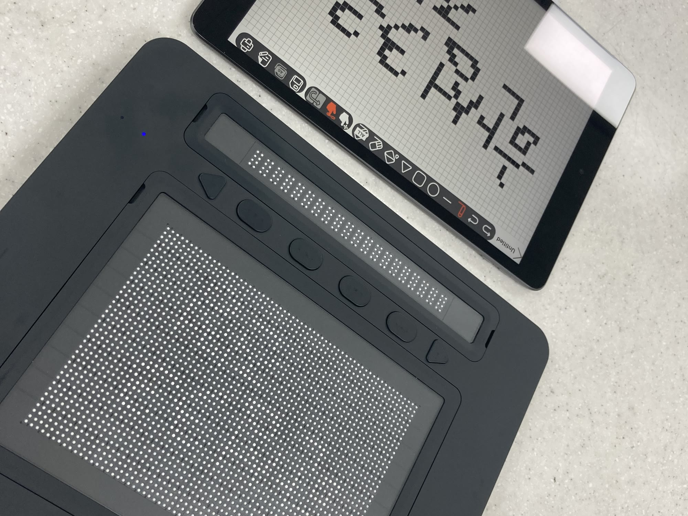

On September 9, 2024, while I was at Dot, I gave a talk to a student club at Hansung Science High School on *Dot and Accessibility for Blind People*. I started with what UX design is. Then I went through how blind people use smart devices with screen readers and refreshable braille displays, and where they get stuck. I also showed Dot Pad and Dot Canvas, which bring tactile graphics into the digital world. At the end the students tried Dot Pad themselves.

 
