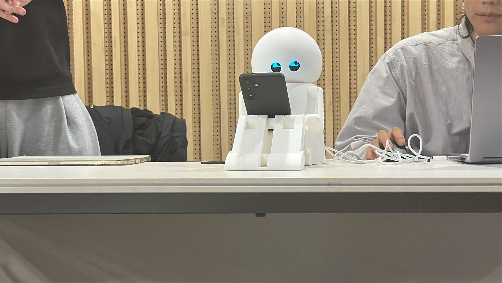
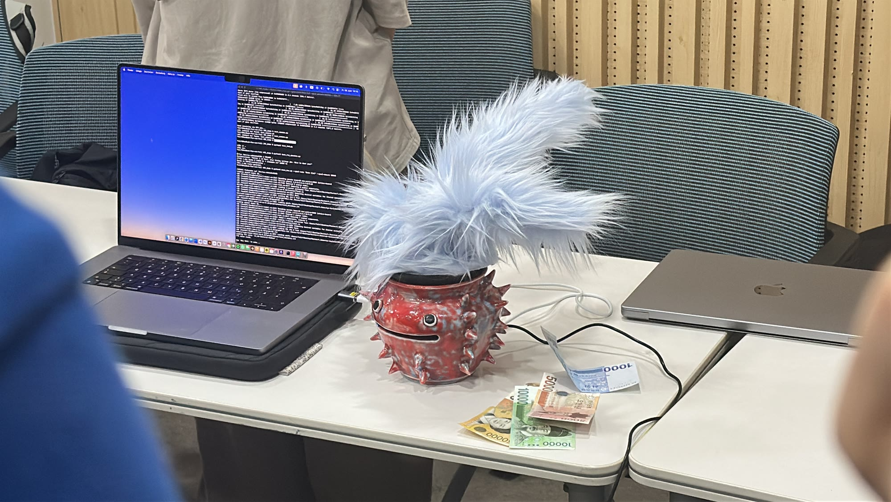
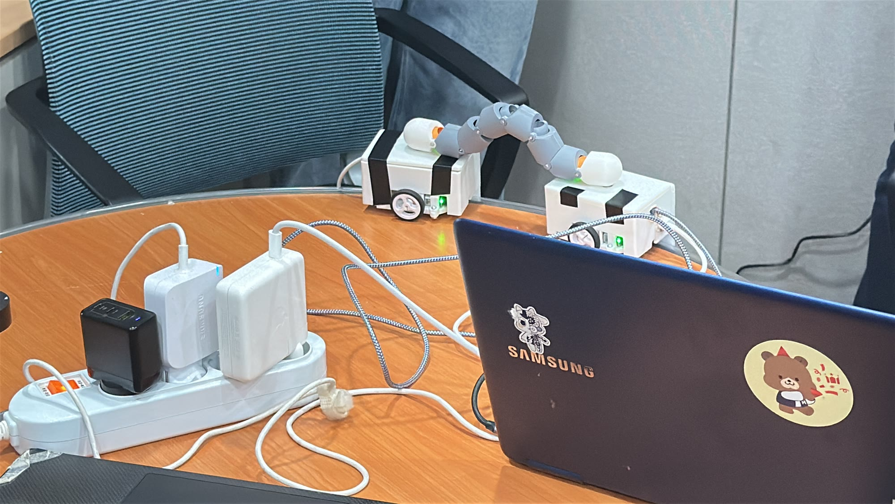
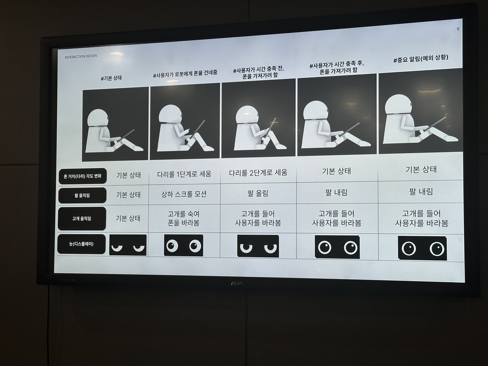
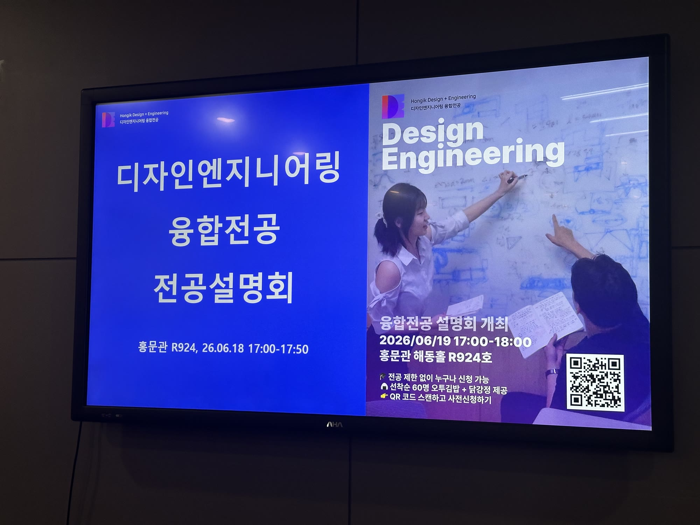
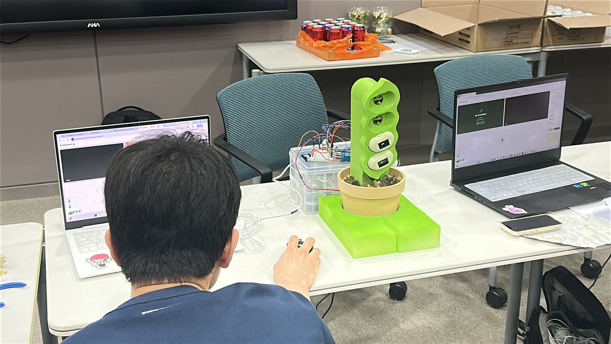

On June 19, 2026, I went back to Hongik University's Design Engineering program as an industry juror for the final presentations of its HRI (Human-Robot Interaction) class. The same day I joined the program's information session as an alumnus.

This is the program where I first found UX while studying mechanical engineering. I'd wished I could take the HRI class since I heard it was opening. Now I work as a UX designer at a robotics company, and I got to review the students' work in person.

Each team saw robots differently, and that view carried into the interaction details: movement, sound, light. The demos went past features: you could see each team working out why a robot should respond the way it does, and I learned a lot from that.

  

  

<iframe src="https://www.youtube-nocookie.com/embed/KmozbRRTfqA?rel=0&modestbranding=1" title="Hongik Design Engineering HRI class projects video" loading="lazy" allow="accelerometer; autoplay; clipboard-write; encrypted-media; gyroscope; picture-in-picture" allowfullscreen></iframe>

