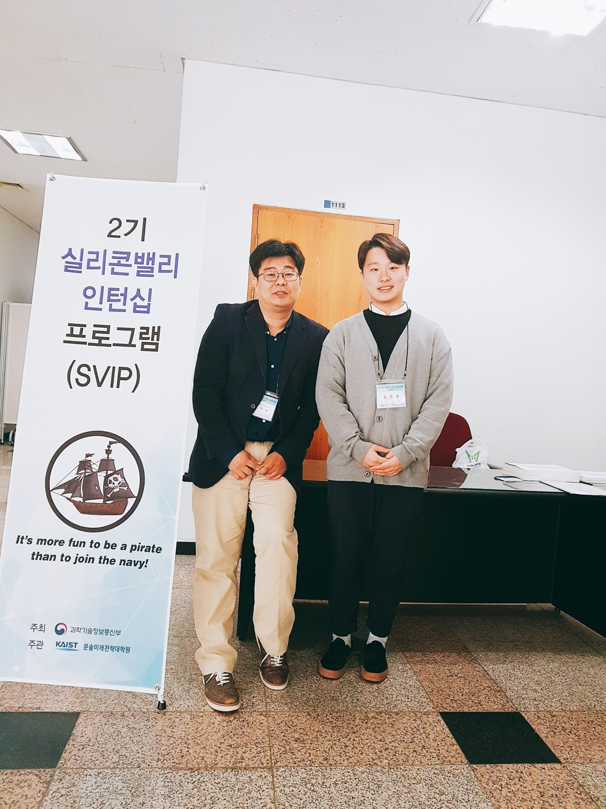
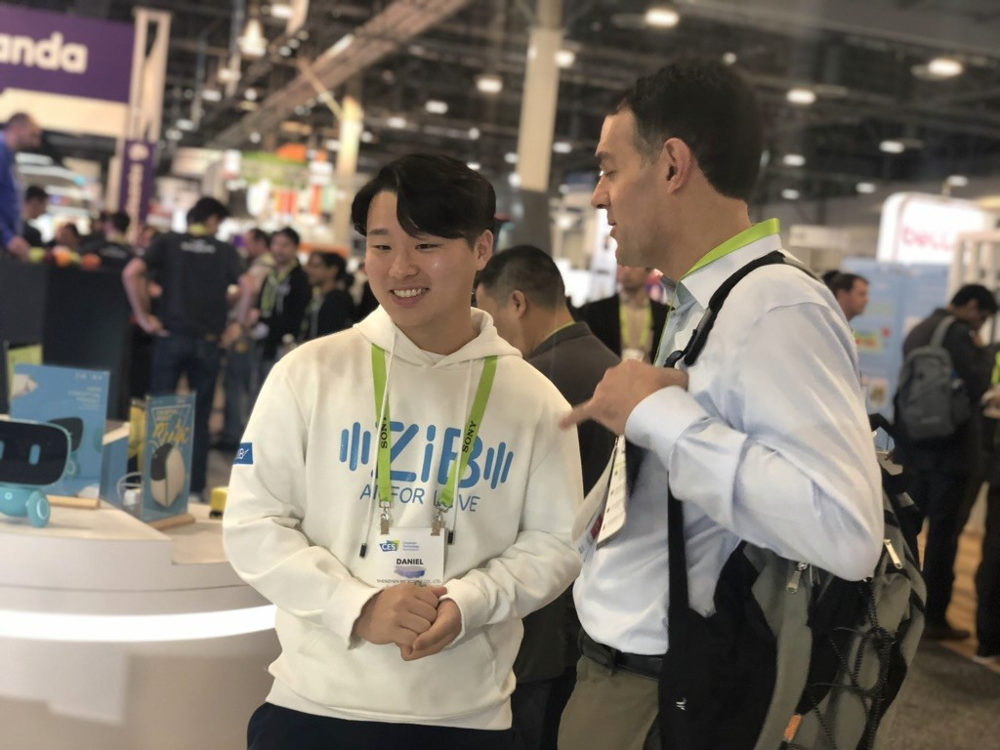

2017년 미래창조과학부와 KAIST 문술미래전략대학원이 운영한 실리콘밸리 인턴십 프로그램(SVIP)에 참여했습니다.

2개월 동안 창업 교육과 선발 과정을 거쳐 12명 안에 들었고, [ZIBOT](/work/zibot)에서 인턴으로 일했습니다. 인턴십은 2018년 2월부터 2019년 1월까지였습니다.

그때 경험은 [블로그](https://silinsta.wordpress.com/)에 적어 두었습니다.

 
