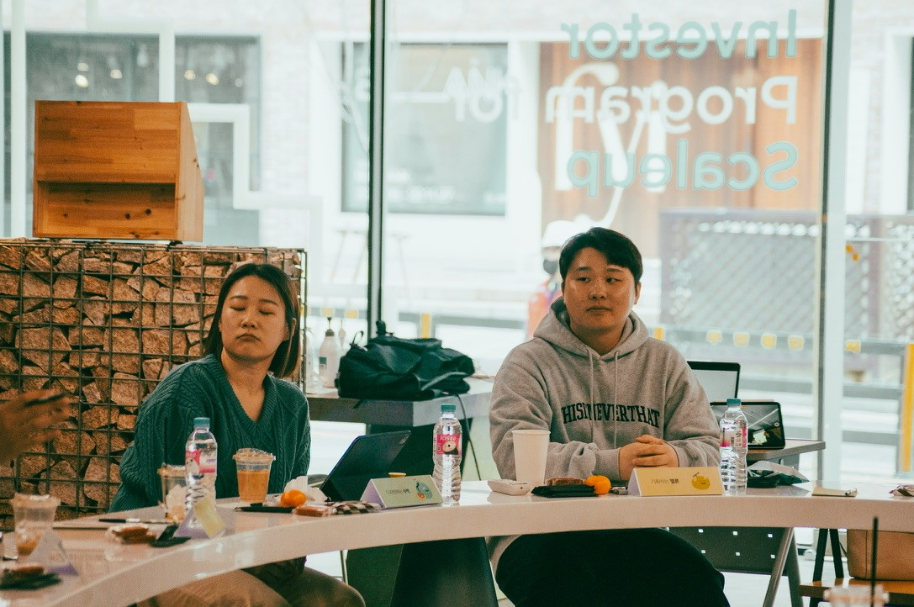
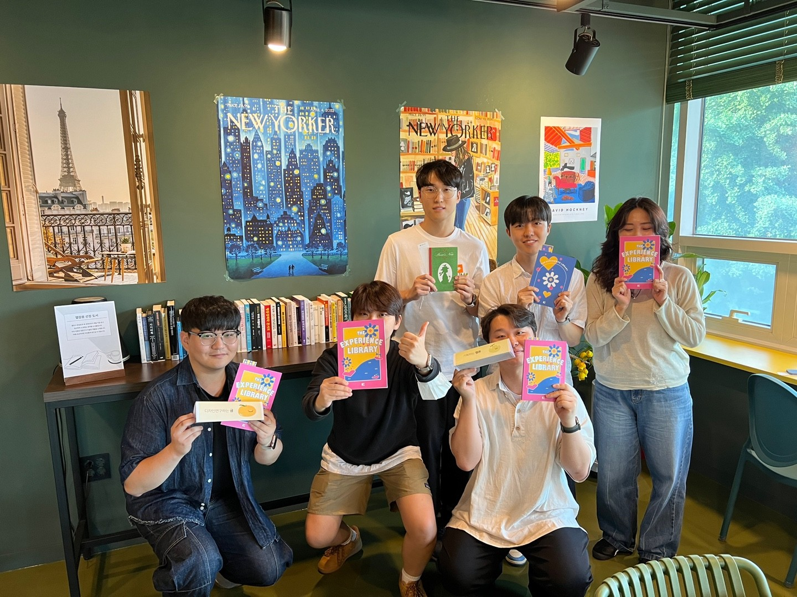

UXeed is short for 'UX + Seed', a UX study group that students and practitioners started on their own.

For two years I was lead manager. I ran the online book study and now and then held book talks and networking events. Nicknames paired a modifier with a fruit or vegetable, and we drew the avatars ourselves, so members took part half-anonymously. I set up the community on Notion and Discord myself.

Most of the first members were students. Now they work as practitioners at different companies. Practitioners from other fields joined along the way. Since I handed it over, the next organizers have kept it going as a networking group.

  
