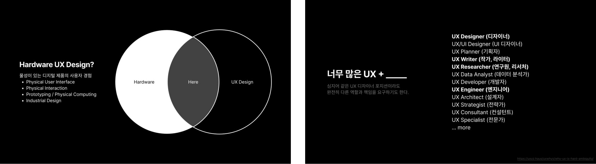
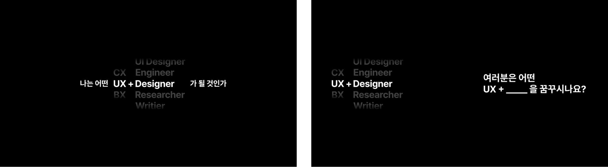

On July 9, 2025, I gave a talk at the Wanted Online UX Conference titled *Designing Your Own Career at the Blurry Edges of UX*.

I talked about a question I'd been carrying since 2017, when I got serious about UX as a mechanical engineering student: what counts as UX design, what doesn't, and what kind of UX designer I want to be. When the invitation came I wasn't sure I was qualified. But that question was exactly why the organizers reached out. They wanted a talk that people asking the same thing could relate to.

The talk boiled down to one simple line.

> [UX + ______]
>
> UX is a posture and a perspective. The blank is the skill you bring to the experience.

My blank is hardware. I announced the talk in [this post](https://www.linkedin.com/feed/update/urn:li:activity:7339094879760748544/) and shared the slides in [a follow-up](https://www.linkedin.com/feed/update/urn:li:activity:7352888194117357568/).

