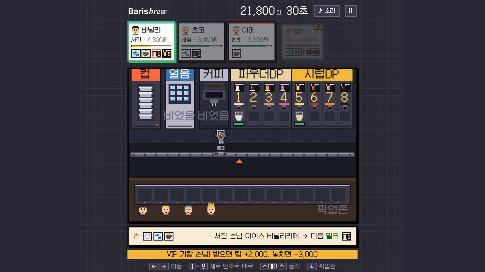
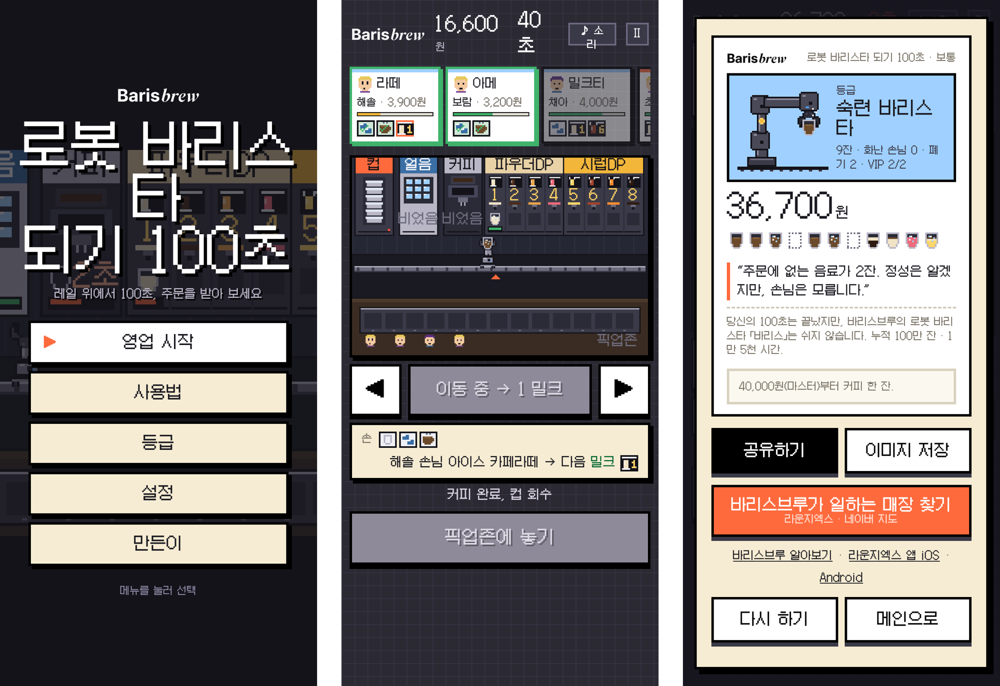

바리스브루는 XYZ의 로봇 바리스타입니다. 이 게임에서는 레일 위 로봇 팔이 되어 100초 동안 주문을 받습니다. 컵을 집어 기계에 걸어 두고, 그 사이에 다음 컵을 집습니다. 설치 없이 링크로 열고, PC는 키보드로, 폰은 터치 버튼으로 합니다. 연휴 동안 재미로 만든 토이 프로젝트입니다.

기기 배치는 실제 유닛을 따랐습니다. 컵·얼음·커피 기계와 파우더 노즐 4개, 시럽 노즐 4개가 레일을 따라 서 있고, 다 된 컵은 앞쪽 픽업존에 놓습니다. 얼음·커피·재료 기계는 컵을 걸어 두면 혼자 일하고 그동안 팔은 자유롭습니다. 그래서 무엇을 먼저 걸어 둘지가 게임의 대부분입니다. 주문 카드의 아이콘 순서가 곧 레시피고, 아이콘에 붙은 번호가 가야 할 노즐입니다. 색만으로는 구분하기 어렵다는 피드백을 받고 번호를 붙였습니다.

바깥에서 처음 보는 사람은 "바리스"를 모릅니다. 그래서 제목은 "로봇 바리스타 되기 100초"로 두고, 로봇 이름은 시작할 때 로봇 목소리로 처음 나오게 했습니다. 결과 카드에서는 바리스가 쉬지 않고 누적 100만 잔을 만들었다는 사실 한 줄로 소개합니다. 처음에는 같은 100초 동안 로봇이 몇 잔을 만드는지 견줘 봤는데, 게임 시간을 줄인 탓에 사람이 로봇을 이겨 버렸습니다. 그래서 비교는 빼고 사실만 남겼습니다.

손님은 회사 동료들 이름으로 넣었고, 경영진 세 분은 VIP 손님입니다. 받으면 팁이 붙고 놓치면 벌금을 냅니다. 등급은 매출로만 정하고, 마스터 바리스타(40,000원)를 넘기면 제가 커피를 한 잔 삽니다.

> 화면 속 손님 이름은 가명으로 바꿔 캡처했습니다.
