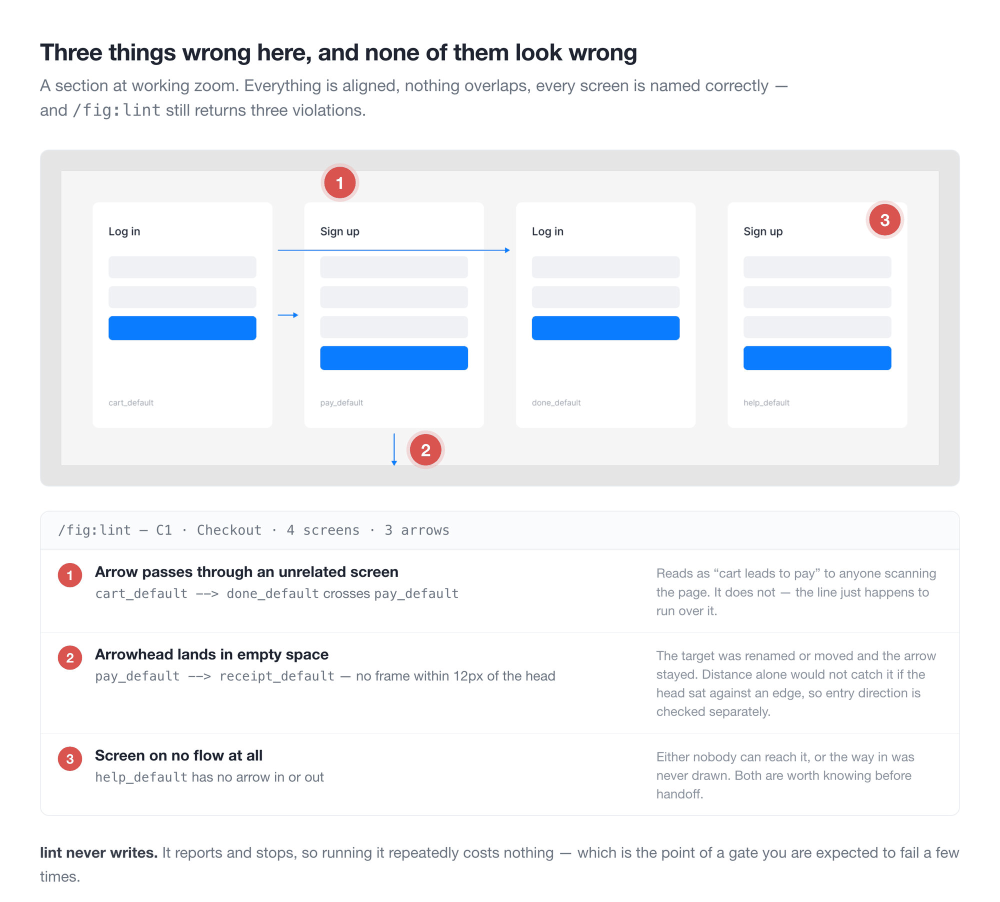
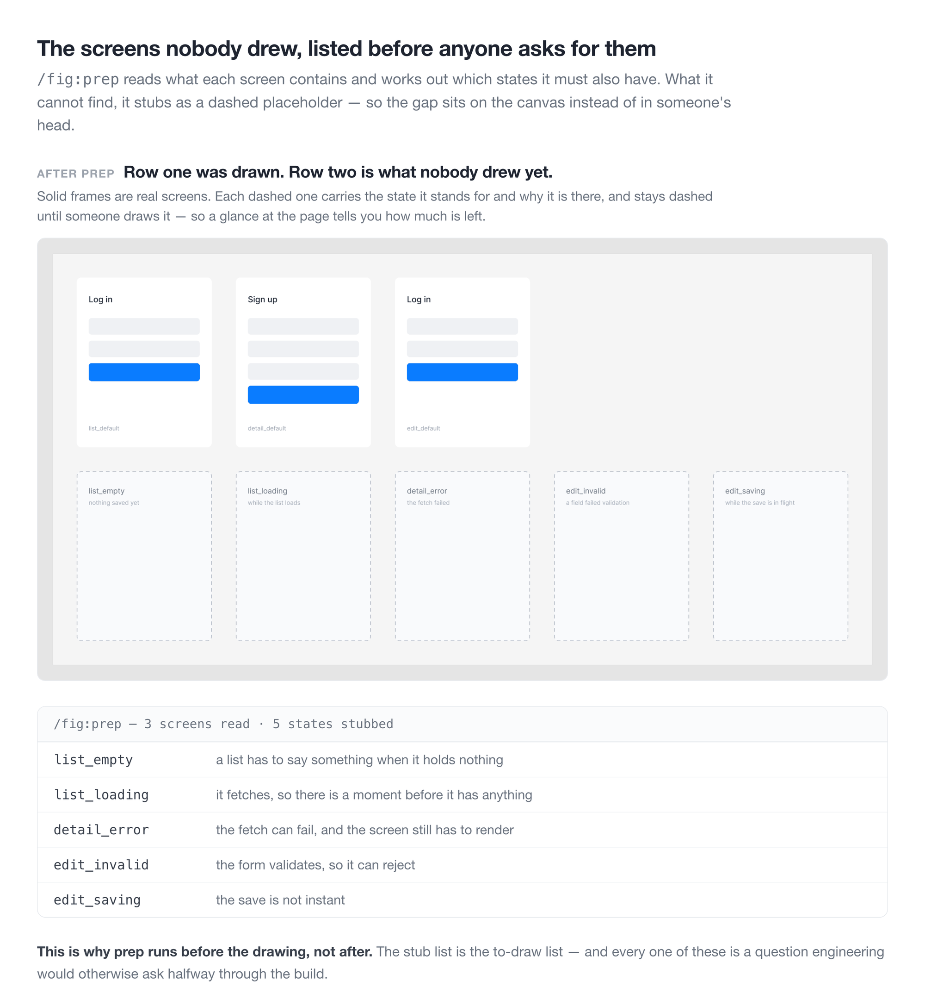
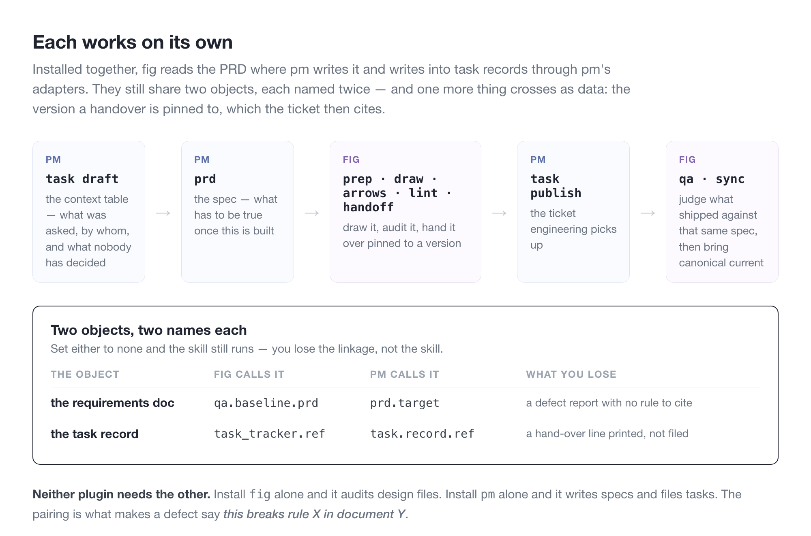
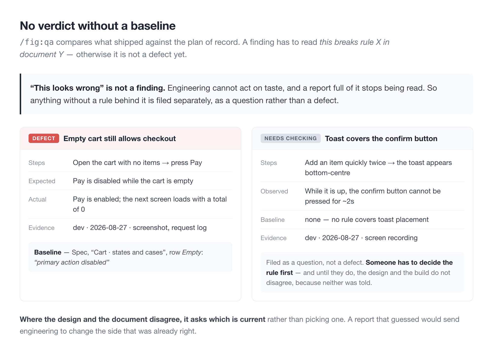

Most Claude Code plugins work on code. fig and pm help with the work next to it: fig with the Figma file you draw in, pm with the spec you write beside it.

fig covers before and after drawing a screen: the to-draw list first, then the audit and sync. It catches settings carried over when a screen is duplicated, a canonical page left stale, broken arrows, and screens nobody drew. pm writes and verifies specs, then drafts, files, and reconciles the tasks.

Only `/fig:lint` decides what is right or wrong. Team conventions are read from the file instead of asked, and anything uncertain stays empty. pm writes only after it shows a preview and gets an approval, except the daily work log, which runs only when called by name and writes one local file.

I built these one at a time for my own work. I use them every day, and so does my UX team.

