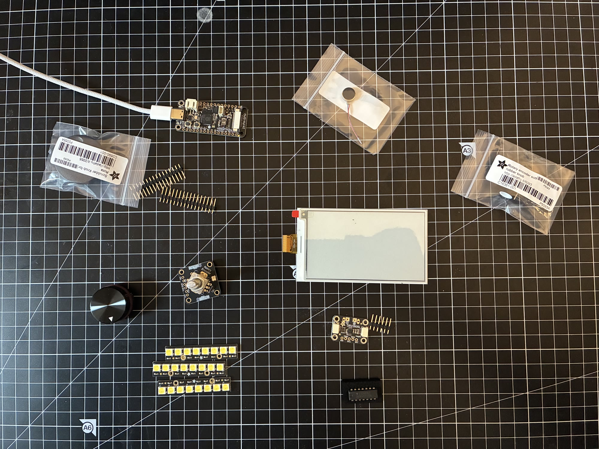
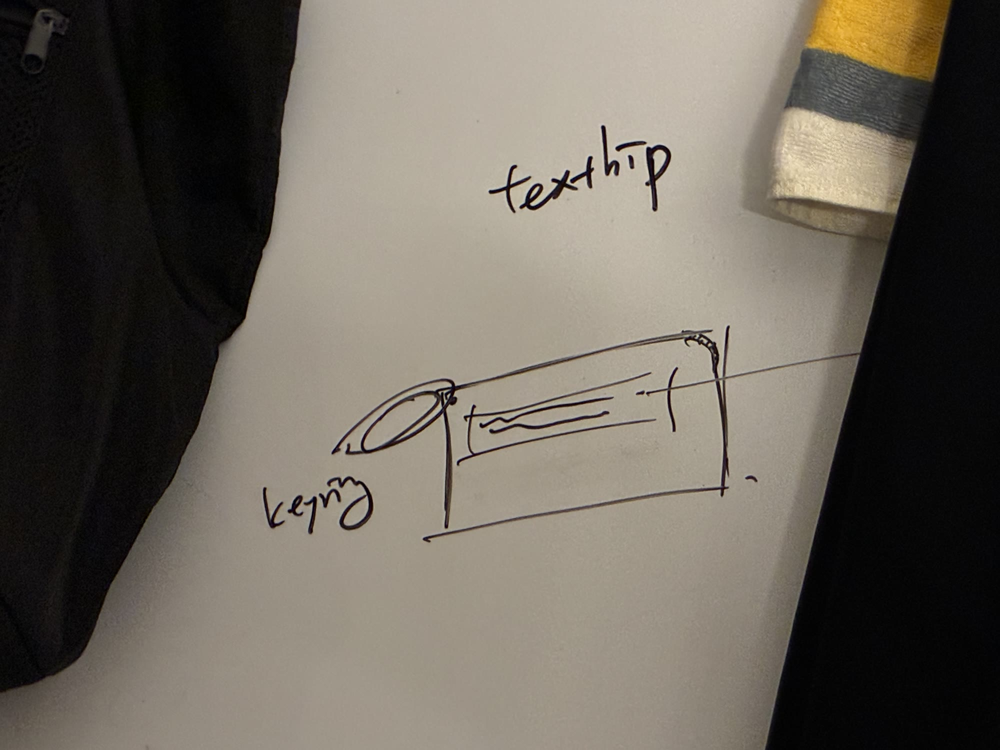
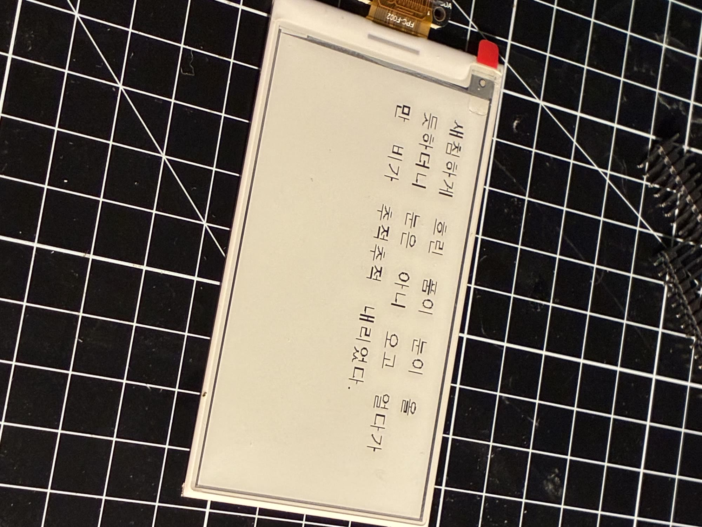
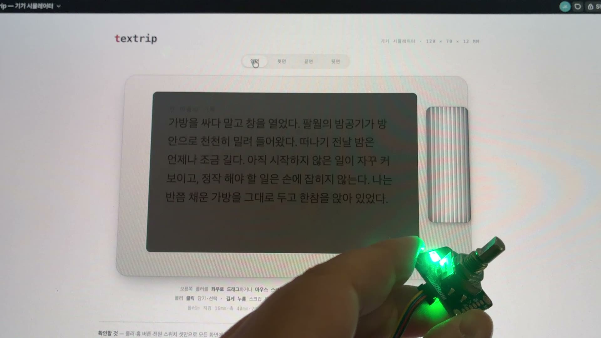
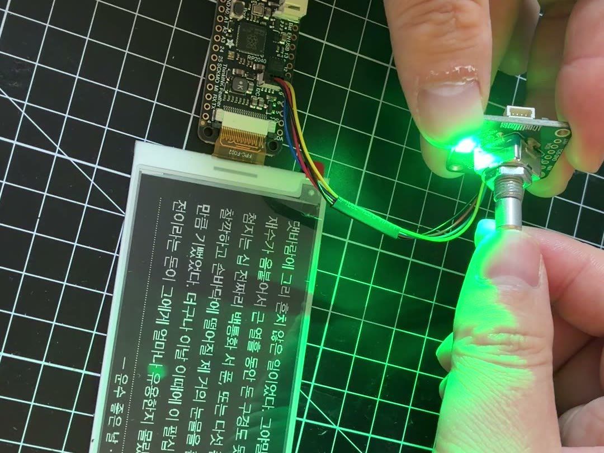

롤러를 손으로 굴려 페이지를 넘기는, 탠저블 인터랙션에 초점을 둔 전자책 리더입니다. 읽기 기능으로는 킨들을 이길 이유도 방법도 없습니다. 그래서 소프트웨어는 기존 전자책의 관례를 따르고, 남는 힘은 읽는 동안 손에 쥐는 물건에 쓰기로 했습니다. 재질과 가공, 촉감 같은 것들입니다.

형태는 12가지를 검토한 끝에 가로로 드는 슬림 바(120 × 70 × 12mm)로 정했습니다. 폭은 화면 크기에서, 길이는 조작계에서 거꾸로 계산했습니다.

페이지는 옆면의 16mm 롤러로 넘깁니다. 한 바퀴에 20칸, 한 칸이 2.51mm라 마우스 휠과 같은 간격입니다. 천천히 굴리면 딸깍이고, 빠르게 굴리면 걸림 없이 돌아갑니다.

납땜 없이 조립한 프로토에서 e-ink 화면 갱신 0.70초, 실사용 한 페이지 넘김 약 1초를 확인했습니다. 다음은 납땜과 알루미늄 시제품입니다.

 

  
