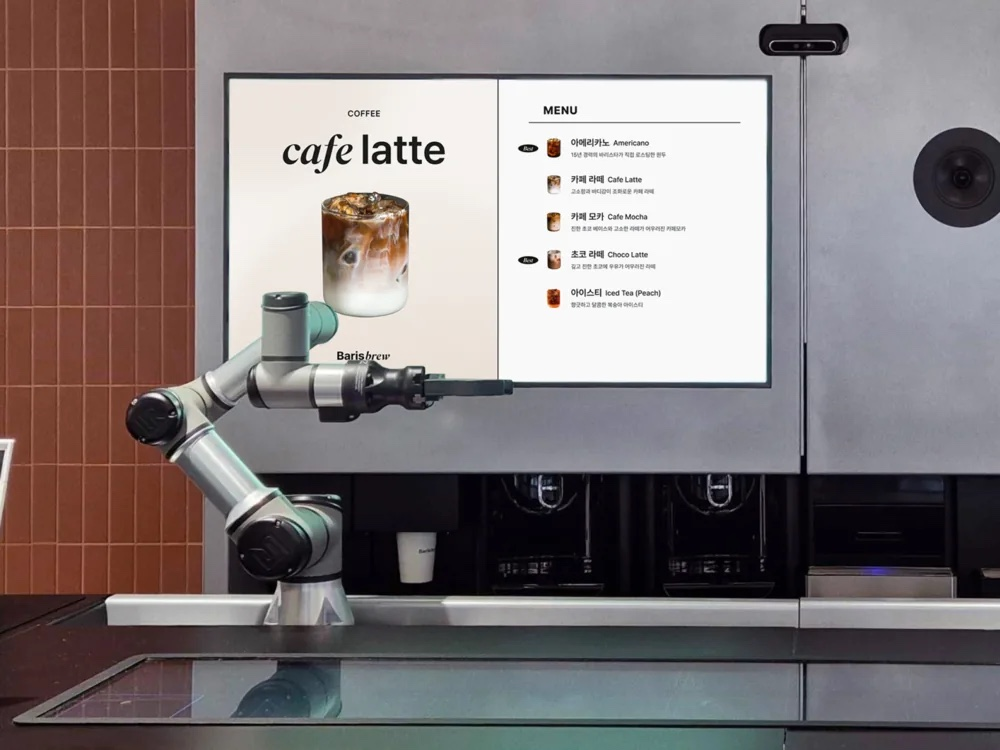
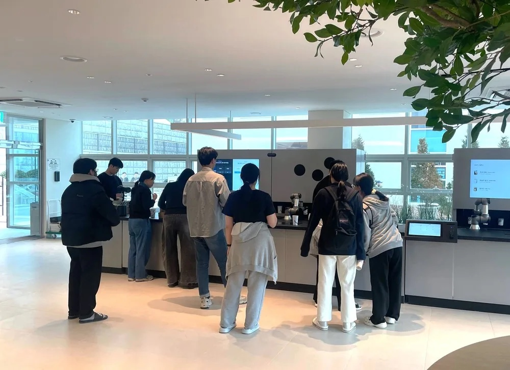
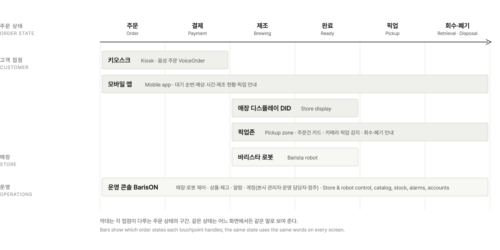
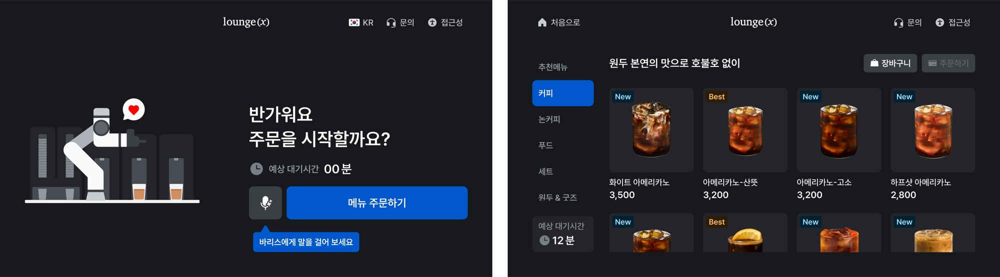
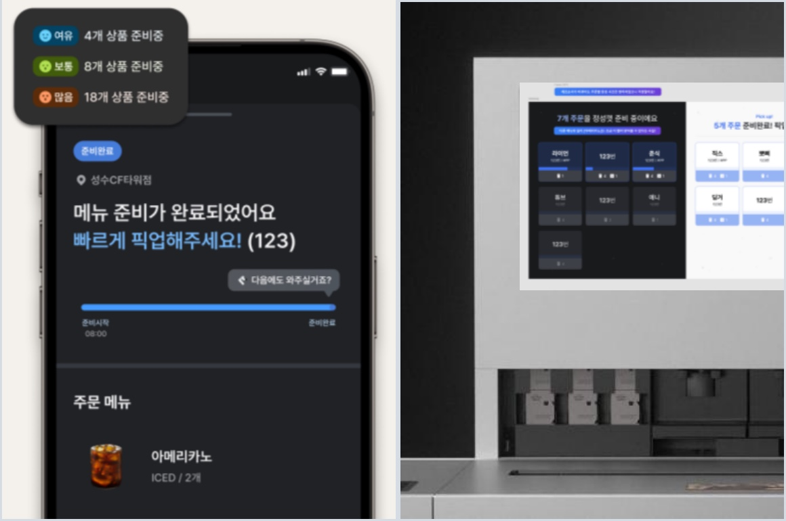
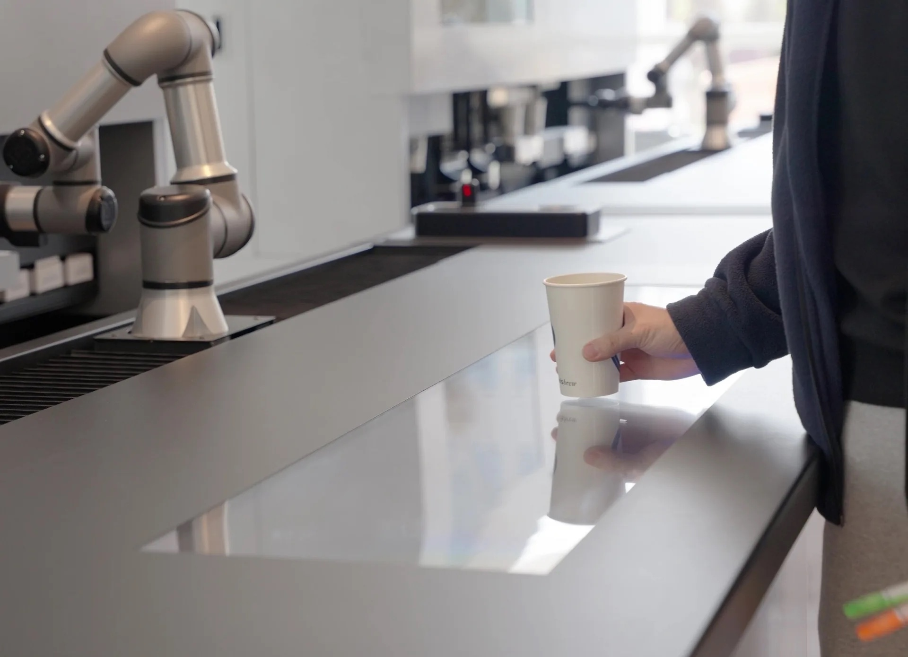
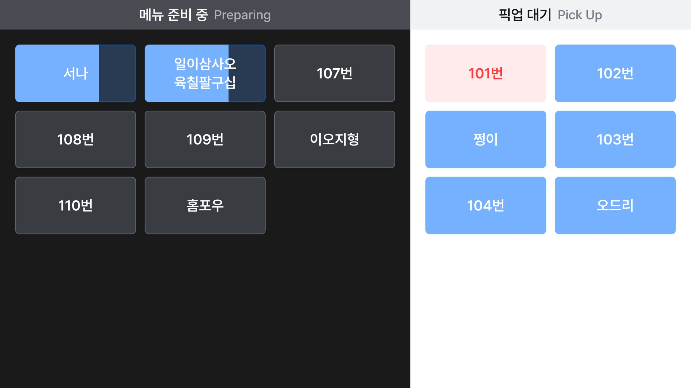
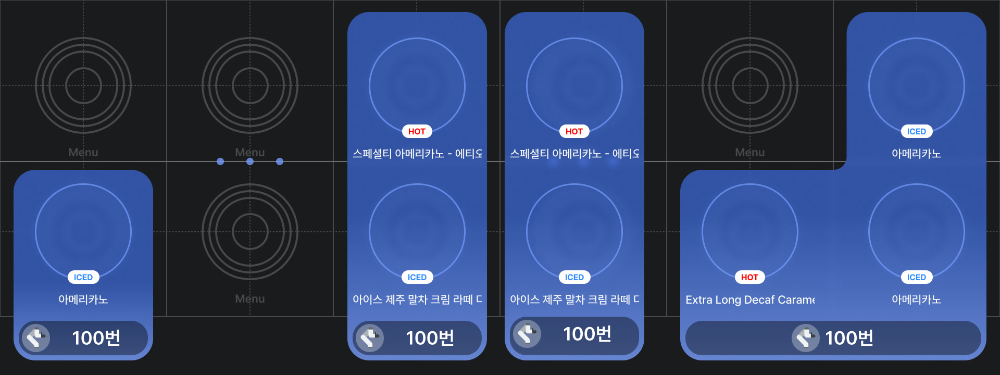
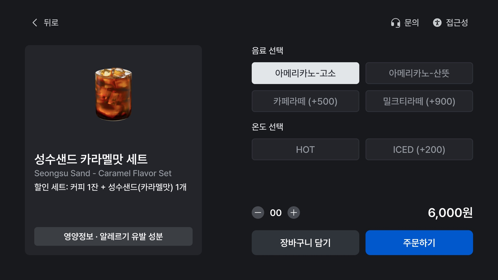

<iframe src="https://www.youtube-nocookie.com/embed/9Q0Kv-1m2nQ?rel=0&modestbranding=1" title="Film introducing the Lounge'X 24-hour unstaffed store" loading="lazy" allow="accelerometer; autoplay; clipboard-write; encrypted-media; gyroscope; picture-in-picture" allowfullscreen></iframe>

## PROBLEM

 

At BarisBrew, a barista robot café, a single order passes through five screens. Customers order at a kiosk or in the app, follow the brewing status on the store display (DID), and collect their drink at the pickup zone. Operators run the store remotely from the back office, BarisON. Each screen had been built at a different time by a different team, so the same state went by different names and an order never read as one flow.

On site, coupons were hard to find, and the coupon confirmation covered the pay button. When orders queued up, order numbers rotated on screen and customers could not judge their wait. In the back office, screen drafts and development had run ahead of planning, leaving the information architecture and permission model undefined.

## APPROACH

I joined in August 2025 to tie the customer channels and the operations console together as one system UX. I worked as one team with two designers, one on the app and one on the web, and as planner and UX lead I kept the flows and policies consistent across the products.

We gathered problems in the field. It started with a trade show operations debrief and an interview with the retail operations lead, and in the summer of 2026 we observed stores directly and mapped usage patterns by store.

Next came the order states. I defined them first, from ordering and payment through brewing, pickup, and retrieval, then aligned the kiosk, app, and displays to show the same state in the same words.

The documents set the rules. Each product got a PRD, and every feature and policy was paired with its Figma screen page. When a screen and a rule disagree, we fix the document first.

Put the order states on one axis and it becomes clear which stretch each of the five touchpoints, the robot, and the operations console covers.

## SOLUTION

The five products were split across the UX team and built together. What follows is the structure and the policies we settled on.

### Kiosk

We organized the flow from the start screen through menu browsing, item detail, order review, and payment. Coupons are applied on the order review screen by scanning a QR code or entering a code, and payment finishes in two screens: choosing a method and following the terminal guidance. To meet the accessibility standard for unattended terminals, the kiosk gained a physical keypad, voice guidance, high contrast, and magnification, and the start screen carries the entry point for voice ordering.

### Mobile app

Customers order before they arrive and see their queue position and expected completion time in the app. The brewing status screen uses one structure for the waiting, brewing, done, and error states, and guides them to pickup when the drink is ready. The [expected wait time](https://www.venturesquare.net/1102926) follows a single rule and is shown the same way on the kiosk and in the app.

### Store display, DID

<video src="/media/works/barisbrew/did.mp4" aria-label="The store display updating orders in brewing and orders waiting for pickup" autoplay muted loop playsinline></video>

In a store with no staff, the display does the calling. It splits orders being brewed from orders waiting for pickup, by order number, and announces completion on screen.

### Pickup zone

The pickup zone shows each order on a display beneath the spot where the cup is placed. It is a tangible interaction: instead of touching a screen, picking up the drink is the input. A camera detects the pickup and clears the card, and exceptions such as retrieval and disposal are worded the same way in the app and on the display. People stand here only for a moment. In that moment they had to see exactly which drink was theirs, and solving that was the part of this project I enjoyed most.

### Operations console, BarisON

BarisON is the console from which headquarters runs unmanned stores remotely. We planned power, status, and camera control for stores and robots, one place to manage the headquarters master catalog and each store's products and stock, an alarm system sorted by how urgent each alarm is for operations, and a three-tier account model for headquarters admins, operations staff, and store owners. We also set common policies such as input form validation and button label conventions.

### Voice ordering, VoiceOrder

<video src="/media/works/barisbrew/voice.mp4" aria-label="A voice ordering demo, from the greeting and a menu question through the order, its confirmation, and pickup" autoplay muted loop playsinline></video>

With the engineering team, I designed the prompts and conversation flow for LLM-based voice ordering: a prompt defining personality, environment, tone, goals, guardrails, and tools; the wake word ("Baris"); barge-in; and the session-end rules and completion screen. The conversation was validated against 12 scenarios, from a basic order to multi-item commands, small-talk interruptions, and budget-based recommendations, and the TTS voice was chosen by listening to the candidates side by side. The kiosk carries the entry point and distinguishes the listening, thinking, responding, and error states with an animation along the screen edge. It was [first demonstrated](https://www.linkedin.com/posts/xyzcorporation_ai-robotcafe-agenticai-activity-7378711064454205440-h9Wl) at the Seoul AI Robot Show in September 2025, [unveiled at RoboWorld 2025](https://www.mt.co.kr/future/2025/11/03/2025110314103736602) in November, and then went into a store pilot. Store noise, microphone pickup, and wake word recognition problems surfaced in operation, and we fixed them by reading the logs. The clip above, from the Lounge'X 24h store film, runs from the greeting and a menu question through an order, its confirmation, and pickup.

## IMPLEMENTATION

PRDs for the kiosk, app, DID, pickup zone, and BarisON link every feature and policy to its Figma screen and keep a change log. Work goes to development in phases.

We checked the designs with a store pilot checklist, barrier-free kiosk QA, and voice order logs. The logs showed people using voice ordering like a voice assistant, and we looked at that again as a UI problem rather than an AI capability problem.

## IMPACT

<iframe src="https://www.youtube-nocookie.com/embed/tAH6xt0qpqk?rel=0&modestbranding=1" title="Film introducing the stores where BarisBrew runs" loading="lazy" allow="accelerometer; autoplay; clipboard-write; encrypted-media; gyroscope; picture-in-picture" allowfullscreen></iframe>

These are the team's results. The system runs in stores of many kinds, including public cultural spaces, apartment community centers, corporate retreats, and unmanned laundromats, and voice ordering went into a store pilot three months after its first demo.

## REFLECTION

BarisBrew runs in real stores, so feedback from the field came straight back into the design. That pushed me to plan for the whole system rather than a single screen, and to ask first how any change would affect operations. Administrators, café operators, and café customers wanted different things. Splitting the work with two designers, one on the app and one on the web, taught me how to lead as one team.

VoiceOrder was one technical issue after another. Store noise, microphone pickup, and wake word recognition only showed their problems once the feature was in operation, and early on we collected logs, monitored, and fixed things often. People also used the feature just for fun, as entertainment, asking it to speak in dialect. If I did it again, I would cut features. I joined after version 1.0 was largely done, and there were too many features; I would keep the core, then put its usability and stability first.

Robots often stop at development, never reach users, or never make money. This project had a robot café in real operation. That let me design the user experience of a robot service directly and get feedback on it. Along the way I moved between the roles of PM, planner, and UX lead.
