## PROBLEM

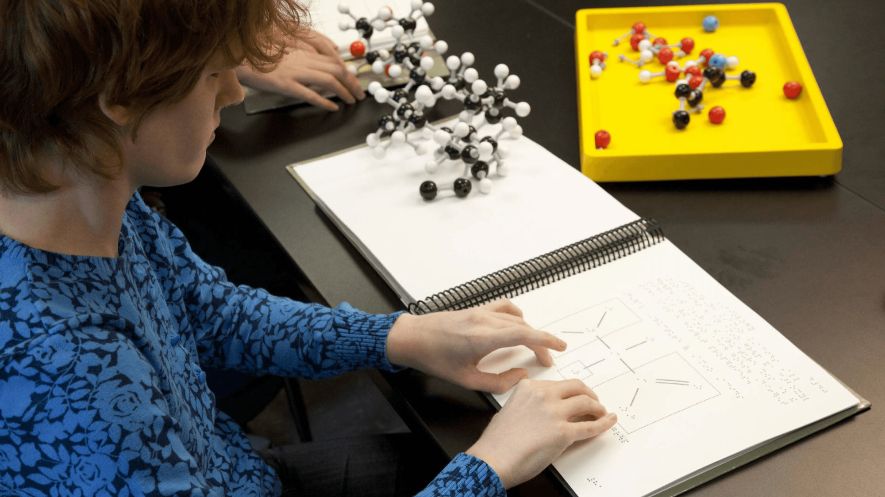

시각장애 학생은 그래픽 정보를 눈으로 확인할 수 없어, 점자 교과서의 촉각 그래픽이나 별도의 촉각 교구로 배웁니다. 그런데 이 촉각 자료가 늘 부족합니다. 점자 교과서의 촉각 그래픽은 만들고 관리하기 어렵고 원본 교과서의 그림을 다 담지 못해 일부만 실립니다. 촉각 교구는 대부분 교사가 직접 만듭니다. 맹학교 수업을 참관하면 테이프와 스티커를 붙여 만든 그림 자료가 나옵니다. 시간과 비용이 많이 들고 내구성이 약해 유지 관리도 어렵습니다.

그만큼 학생은 배울 거리가 줄고 교사는 자료를 만드는 데 시간을 씁니다. 촉각 자료를 다르게 만들 방법이 필요했습니다.

## APPROACH

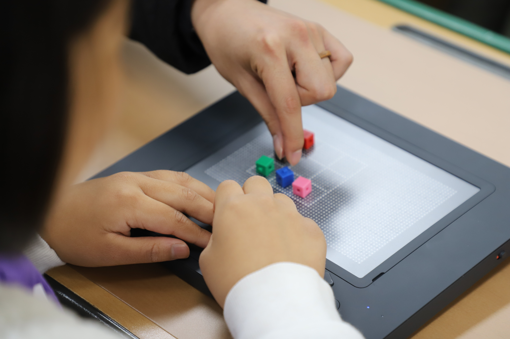 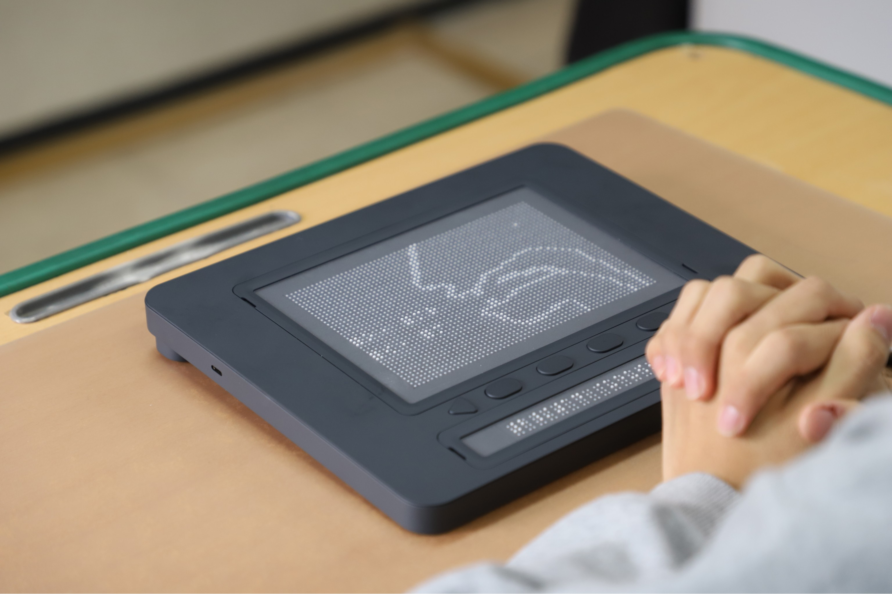

2022년 7월 닷에 하드웨어 UX 디자이너로 합류했지만 첫 일은 하드웨어가 아니었습니다. 촉각 디스플레이 닷패드는 올릴 촉각 그래픽이 있어야 쓸모가 있는데, 그것을 만드는 도구가 없었습니다. 서비스 기획자, GUI 디자이너와 한 팀으로 3개월 안에 저작 도구 닷 캔버스의 웹과 앱 데모를 내는 것이 목표였습니다.

촉각 그래픽은 만드는 사람과 만지는 사람이 다릅니다. 웹은 교사가 자료를 만들고 관리하는 쪽에, 앱은 시각장애 사용자가 직접 그리고 만지는 쪽에 맞췄습니다. 국내에서는 특수학교 교사와 시각장애 학생을 대상으로 필드 스터디를, 해외 사용자는 설문과 다이어리 스터디로 사용 환경과 페인포인트를 조사했습니다. 초기 캔버스의 문제와 고칠 방향은 이 조사에서 나왔습니다.

캔버스를 내보낸 뒤에는 닷패드 하드웨어로 넘어갔습니다. 점자 디바이스 20종 이상을 비교해 촉각 표기 방식과 차기 모델의 스펙과 요구사항을 정했습니다. 키 기능과 햅틱과 LED 피드백도 설계해 양산 모델에 넣었습니다.

## SOLUTION

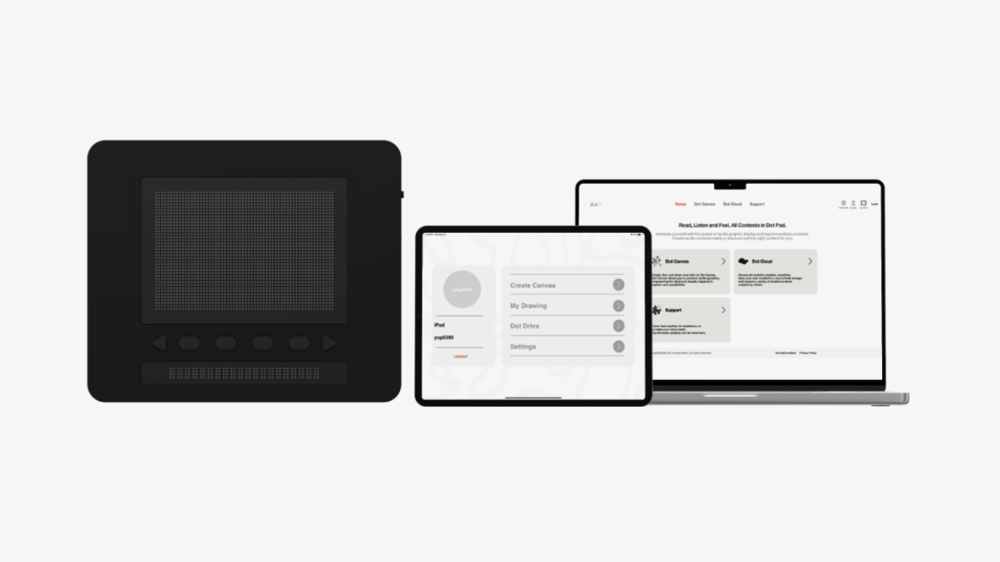

<iframe src="https://www.youtube-nocookie.com/embed/N_L3hR81nik?rel=0&modestbranding=1" title="닷 캔버스 소개 영상" loading="lazy" allow="accelerometer; autoplay; clipboard-write; encrypted-media; gyroscope; picture-in-picture" allowfullscreen></iframe>

### Dot Canvas 웹

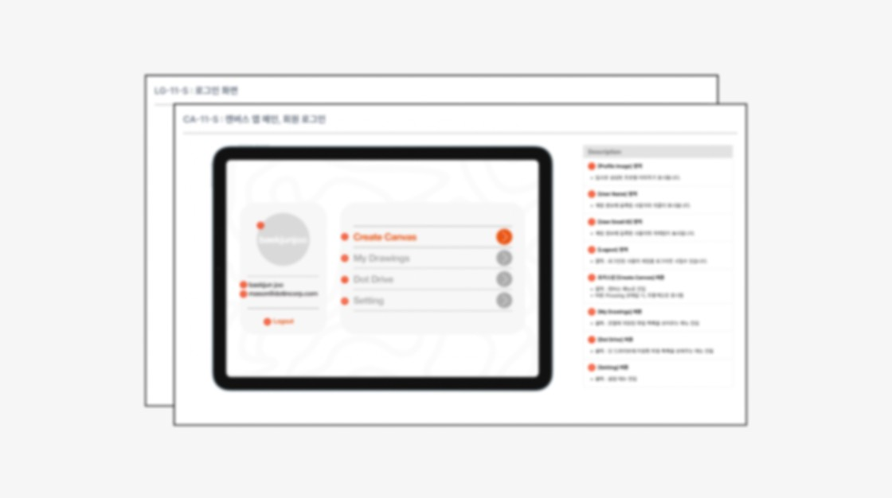

교사가 브라우저에서 촉각 그래픽을 그리거나 PDF나 이미지를 불러와 변환합니다. 만든 자료는 닷 클라우드에 저장되고 공용 드라이브로 다른 교사와 나눕니다. 수업에서는 닷패드 최대 10대에 같은 그래픽을 동시에 띄워, 학생들이 같은 그림을 만지며 이야기할 수 있습니다.

### Dot Canvas 앱

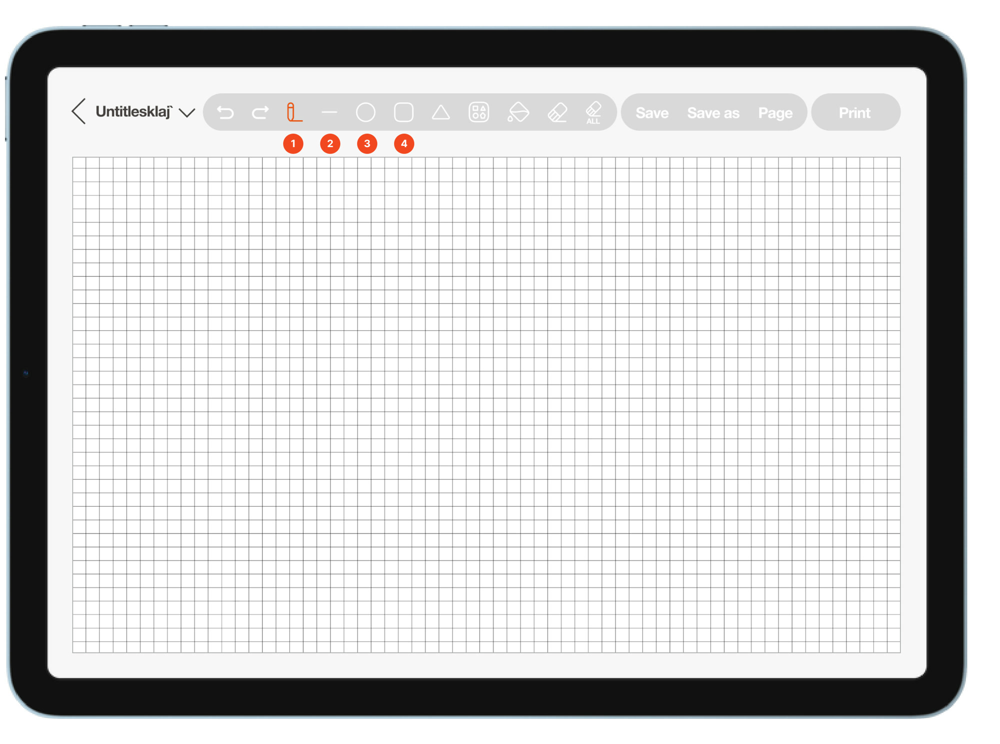

아이패드의 터치와 애플 펜슬로 그립니다. 보이스오버와 라이브 드로잉을 지원해 시각장애 사용자도 직접 그리고 그린 것을 바로 닷패드로 만져 봅니다. 파일은 닷 클라우드로 웹과 공유됩니다.

### Dot Pad

<iframe src="https://www.youtube-nocookie.com/embed/iSmRM2PUBzA?rel=0&modestbranding=1" title="닷패드 소개 영상" loading="lazy" allow="accelerometer; autoplay; clipboard-write; encrypted-media; gyroscope; picture-in-picture" allowfullscreen></iframe>

닷패드는 그래픽을 띄우는 여러 줄 촉각 영역과 그 아래 한 줄 점자 영역, 그리고 물리 키로 이뤄져 있습니다. 시각장애 사용자는 키를 보고 고를 수 없습니다. 같은 키는 언제나 같은 일을 해야 하고 손끝으로 구분돼야 합니다. 그래서 키마다 기능을 하나로 고정하고 손으로 구분할 수 있는 표기를 더했습니다. 입력이 들어갔는지, 기기가 지금 어떤 상태인지는 햅틱과 LED로 알립니다. 이 피드백은 양산 모델에 들어갔습니다. 사용자 평가에서 나온 의견은 차기 모델로 넘겼습니다.

## IMPLEMENTATION

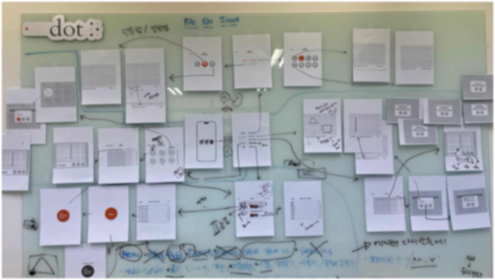

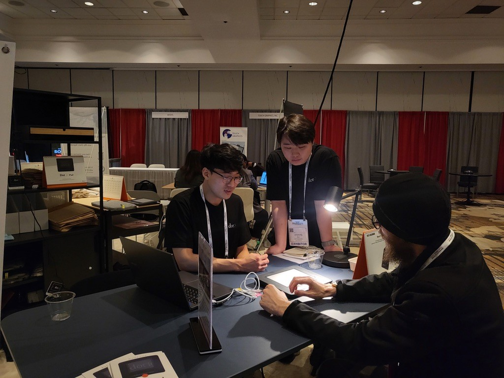 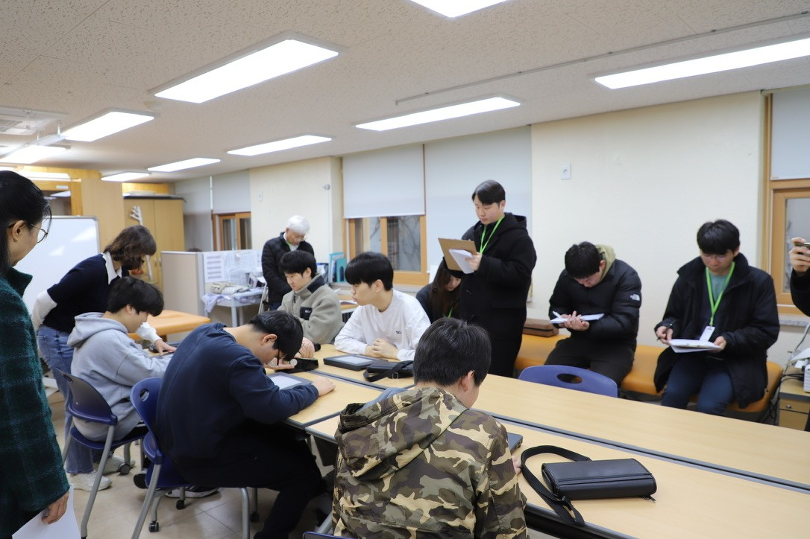 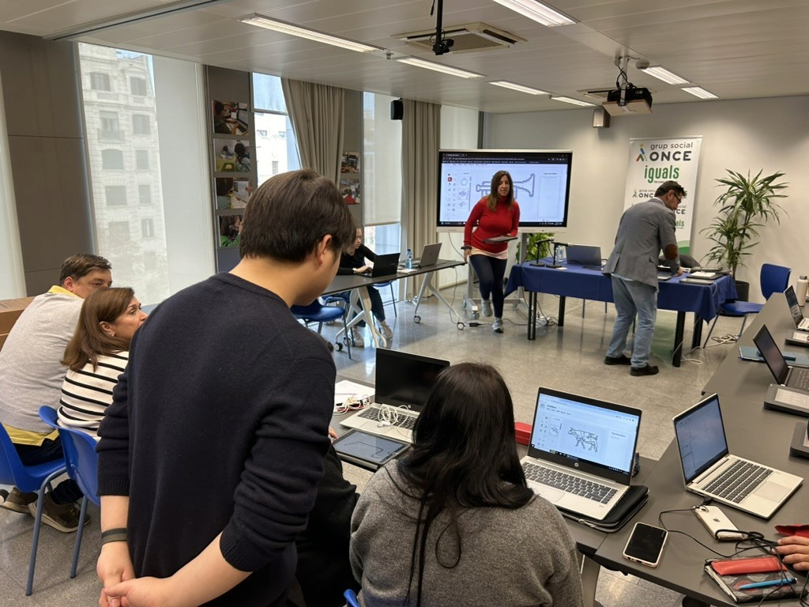

닷 캔버스 웹과 앱의 화면은 리서치에서 나온 것을 바탕으로 Figma에서 설계했고 GUI는 GUI 디자이너와 함께 만들었습니다. 교사와 시각장애 학생이 같이 쓰는 화면이라 구조와 기능 배치를 두 사람 모두에 맞췄습니다.

화면 설계서와 기능 명세서를 쓰고 이슈는 JIRA로 관리했습니다. 기술적으로 바뀌는 부분은 개발팀과 맞춰 가며 기능 개선과 출시 일정을 조율했습니다.

## IMPACT

<iframe src="https://www.youtube-nocookie.com/embed/AHK3VnjvA5Y?rel=0&modestbranding=1" title="인천혜광학교의 닷패드 사용 사례 영상" loading="lazy" allow="accelerometer; autoplay; clipboard-write; encrypted-media; gyroscope; picture-in-picture" allowfullscreen></iframe>

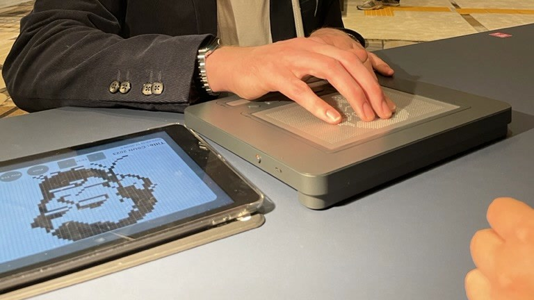 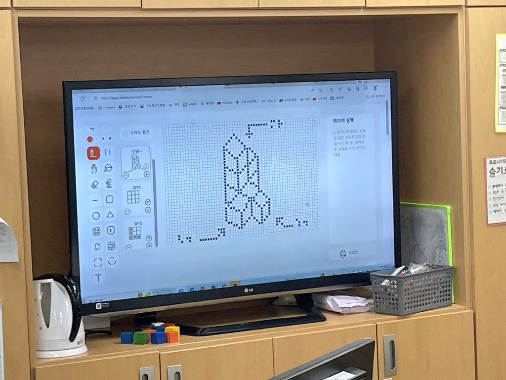

닷 캔버스는 CSUN 2023 부스에서 시연했고 CES 2024 Innovation Award를 받은 뒤 CSUN 2024에도 출품했습니다. 닷패드의 촉각 인터페이스는 양산 모델에 들어갔습니다. 2024년 참관한 맹학교 과학 수업에서는 테이프와 스티커로 만들던 그림 자료가 닷패드로 대체돼 있었습니다.

## REFLECTION

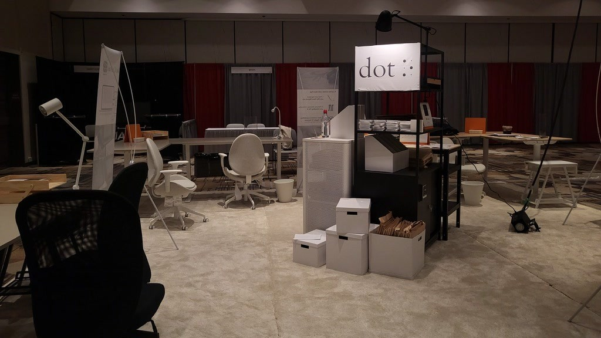

닷 캔버스는 짧은 기간 안에 웹과 앱의 데모를 내야 하는 프로젝트였습니다. 팀에 관련 경험이 있는 사람이 부족했고 3개월 안에 쓸 수 있는 결과물을 만들어야 했습니다. 화이트보드를 채워 가며 빠르게 프로토타입을 만들었고 UX 설계와 함께 개발팀과의 협업, 일정 관리도 맡았습니다.

서두른 값은 나중에 치렀습니다. 3개월 목표는 지켰지만 넓혀 쓸 것을 생각하지 못한 설계라 유지보수 때 고칠 것이 많았고 덜 다듬어진 곳도 남았습니다. 사용자 스터디에서 피드백을 직접 받으면서 속도와 완성도 사이에서 균형을 잡는 일이 UX 설계에서 얼마나 중요한지 실감했습니다.

가장 많이 배운 건 사용자에게서였습니다. 시각장애인 사용자를 가까이에서 만나면서 접근성은 다 만든 뒤에 붙일 수 없고 처음 설계할 때부터 넣어야 한다는 걸 알게 됐습니다.
