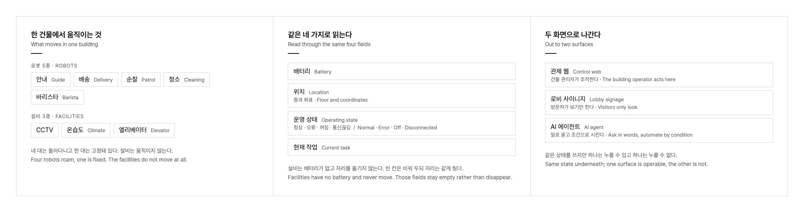
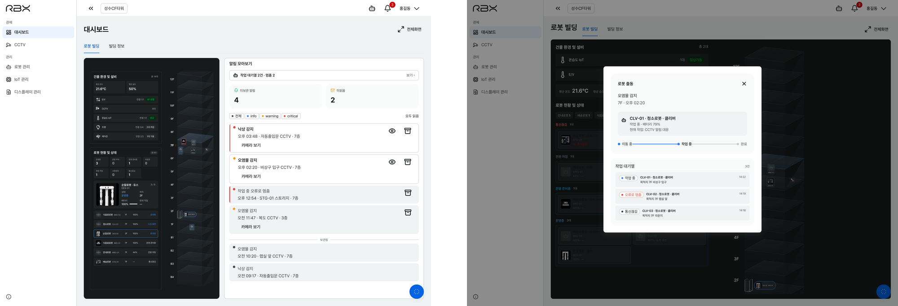

<iframe src="https://www.youtube-nocookie.com/embed/TPq3F_mAeP8?rel=0&modestbranding=1" title="로봇 빌딩 솔루션 소개 영상" loading="lazy" allow="accelerometer; autoplay; clipboard-write; encrypted-media; gyroscope; picture-in-picture" allowfullscreen></iframe>

## PROBLEM

한 건물 안에서 안내, 배송, 순찰, 청소 로봇과 바리스타 로봇이 함께 일합니다. 여기에 CCTV와 온습도 센서, 엘리베이터가 따로 돌아갑니다. 그런데 로봇은 저마다 자기 관제 화면을 갖고 있었고 설비는 또 다른 데서 봤습니다. 건물을 맡은 사람이 "지금 이 건물이 어떤 상태인가"를 한 번에 볼 자리가 없었습니다.

관제만의 문제도 아니었습니다. 로비를 지나는 사람에게도 이 건물이 로봇으로 돌아간다는 사실이 보이지 않았습니다.

## APPROACH

관리 대상과 상태, 화면 목록을 정의하는 일부터 맡았습니다. 로봇 5종과 설비 3종을 놓고 무엇을 어떤 이름으로 읽을지, 그것이 어느 화면에 어떻게 나타날지를 문서로 세웠습니다.

상태는 4가지로 통일했습니다. 형태도 역할도 다른 8종을 한 화면에서 나란히 읽으려면 축이 같아야 합니다. 배터리, 위치, 운영 상태, 현재 작업. 설비는 배터리도 없고 자리를 옮기지도 않지만 칸을 없애지 않고 비워 뒀습니다. 목록에서 자리가 흔들리는 편이 더 읽기 어렵습니다.

응답이 없는 것과 꺼진 것을 갈랐습니다. 로봇이 30초 넘게 상태를 갱신하지 않으면 서버가 통신끊김으로 돌립니다. 꺼 둔 로봇과 연락이 끊긴 로봇은 관리자가 할 일이 다릅니다.

화면은 두 벌로 나눴습니다. 같은 상태를 쓰지만 관제 웹은 건물 관리자가 누르는 화면이고 로비 사이니지는 방문자가 보기만 하는 화면입니다.

## SOLUTION

### 관제 웹

건물 단면 위에 로봇 위치를 띄우고 로봇과 설비의 현황을 한 패널에 모읍니다. 항목을 고르면 배터리와 위치, 지금 하는 일이 펼쳐집니다. 이상 상황은 정보, 경고, 긴급 3단계로 나눠 알리고 알림에서 바로 그 자리의 CCTV를 열거나 로봇을 출동시킵니다. 출동한 로봇은 이동 중, 작업 중, 완료로 진행이 보이고 밀린 일은 작업 대기열에 쌓입니다. 1층 조명과 에어컨을 켜고 끄는 일, 로봇과 IoT 기기 연결, 기기 이름 바꾸기, 층 정보와 공지 관리, 계정 발급까지 관제 웹에서 합니다.

### 로비 사이니지

<video src="/media/works/rbms/signage.mp4" aria-label="같은 사이니지 화면의 세 시점. 층을 옮겨 다니는 로봇과 바뀌는 온습도" autoplay muted loop playsinline></video>

같은 데이터를 방문자용으로 다시 짰습니다. 건물을 세로로 자른 단면에 층마다 로봇을 얹어, 지금 어느 층에서 무엇이 움직이는지가 멀리서도 읽히게 했습니다. 옆에는 설비 상태와 로봇 목록, 건물 공지가 붙습니다. 공지와 층별 입주사 안내는 이미지로 올리던 것을 글로 입력하게 바꿨습니다. 건물 관리자가 관제 웹에서 바로 고칠 수 있고 멀리서도 글자가 또렷합니다. 로비의 스탠드형 디스플레이도 관제 웹에서 올린 이미지를 돌아가며 띄웁니다.

### AI 에이전트

<video src="/media/works/rbms/console.mp4" aria-label="로비 대화 화면과 건물 단면 대시보드를 함께 띄운 관제 화면" autoplay muted loop playsinline></video>

관제 웹 어느 화면에서든 상단 버튼으로 대화 패널 ROBI를 엽니다. "건물의 로봇 상태를 정리해서 알려줘"처럼 말로 묻고 답과 로봇 이벤트 알림이 같은 타임라인에 쌓입니다.

## IMPLEMENTATION

요구사항과 정보 구조, 화면 스펙을 문서로 세우고 대시보드와 사이니지 화면을 디자인했습니다. 2026년 9월부터는 화면 구현도 맡았습니다. 서버는 개발팀이 만들고 관제 웹과 사이니지의 화면 코드는 제가 직접 써서 실제 로봇과 설비에 붙여 확인했습니다. 화면 전체를 사내 디자인 시스템으로 옮기는 일도 이때 함께 했습니다.

시뮬레이션 모드와 실데이터 모드가 같은 인터페이스를 씁니다. 로봇과 서버가 없는 자리에서도 전체 흐름을 그대로 보여 줄 수 있습니다.

## IMPACT

로봇마다 흩어져 있던 관제가 건물 단위로 묶였습니다. 관제 웹은 성수 사옥의 로봇과 설비를 한 화면에 보여 주고 1층 조명과 에어컨을 실제로 켜고 끕니다. 로비 사이니지와 스탠드형 디스플레이도 관제 웹에서 내용을 받아 건물에 걸려 있습니다.
