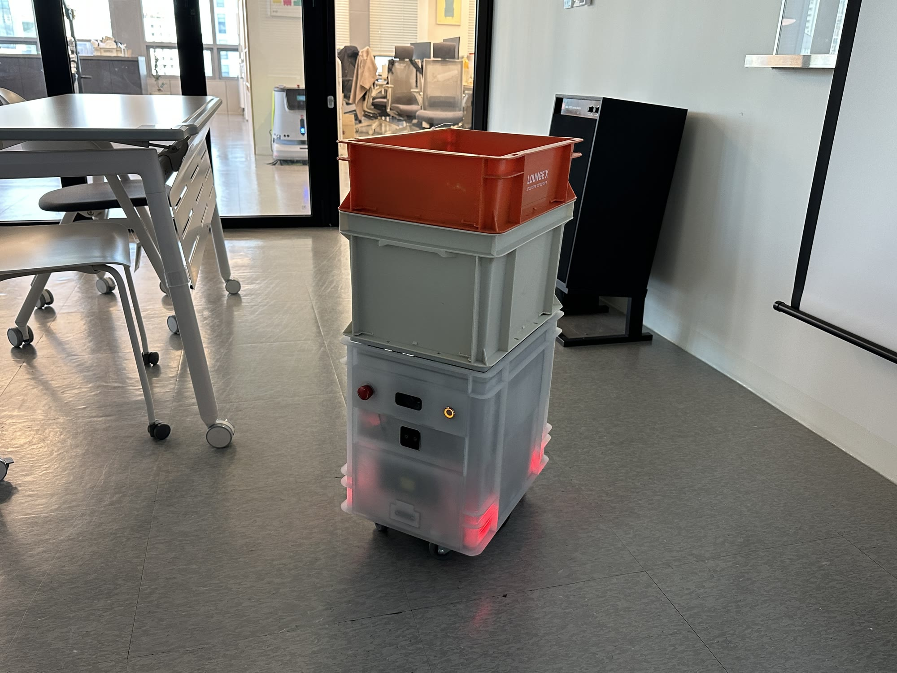
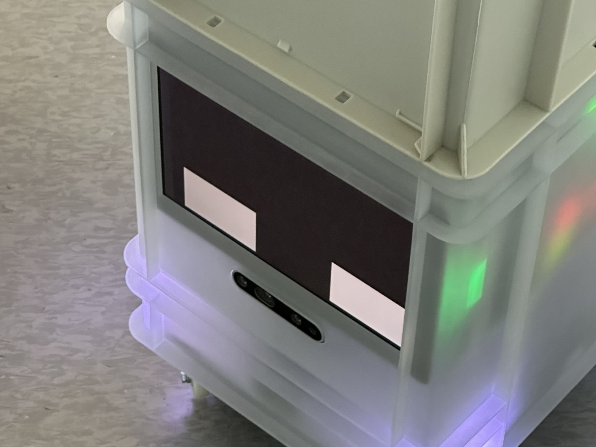

<iframe src="https://www.youtube-nocookie.com/embed/TPq3F_mAeP8?start=28&rel=0&modestbranding=1" title="The Robot Building Solution film, starting at the STORAGY segment" loading="lazy" allow="accelerometer; autoplay; clipboard-write; encrypted-media; gyroscope; picture-in-picture" allowfullscreen></iframe>

## PROBLEM

STORAGY, an indoor delivery robot, shares hallways, elevators, and offices with people. It has to say without words whether it is waiting, moving, stopped by an obstacle, or done delivering, so that people make way and pick up what it brought. At the start there was no defined list of robot states, and no rules for the face and the light that would show them.

## APPROACH

We defined the robot's states first, then split the channels. The robot reports two kinds of state: system state, such as booting, normal, warning, error, and battery, and operation state, such as idle, driving, docked, and the task at hand. System state has to be readable by an operator from anywhere at a glance, so it went to the LED under the body, with sound. Driving state has to be read by the person in front of the robot, so it went to the face on the front display, with sound. A table pairing display and LED feedback for each state became the reference, with sound added afterward. Engineering built to the states as defined, and we put it on the real robot and revised as we went.

## SOLUTION

### Faces

<video src="/media/works/storagy/faces.mp4" aria-label="The six state faces, each labelled: obstacle, booting, idle, charging, moving, and delivered" autoplay muted loop playsinline></video>

I made the representative face and animation for six states: booting, idle, moving, obstacle, charging, and delivery complete. The position, size, and motion of two eyes are all that separate the states.

### LED and display

 

<video src="/media/works/storagy/led.mp4" aria-label="Close-up of the eyes on the front display and the LED under the body lit together" autoplay muted loop playsinline></video>

The front display carries the face; the LED under the body shows the system state. The face tells the person in front of the robot what it is doing now, and the LED shows booting, normal, warning, error, and charging through the color and pattern of the light. One mapping table keeps the two channels from saying different things about the same state.

### Multi-floor delivery

<video src="/media/works/storagy/delivery.mp4" aria-label="STORAGY moving down a corridor, riding the elevator, and delivering to an office" autoplay muted loop playsinline></video>

STORAGY takes the drinks BarisBrew makes, rides the elevator, and delivers them to the desk. I defined the scenarios and states for this multi-floor delivery and planned the features and screens of MobileON, the console that controls the robot remotely. A face was added for each step of the elevator ride, calling, boarding, choosing the floor, and getting off, along with faces for a blocked path and for error and emergency stop.

## IMPACT

It runs floor-to-floor delivery with BarisBrew in the Robot Building Solution at the XYZ headquarters in Seongsu, Seoul.

When multi-floor delivery came in, it used the same rules for states and faces set at the start. That is how four elevator steps, calling, boarding, choosing the floor, and getting off, plus a blocked path and an error and emergency stop, were added. Impact detection has its key reserved, to be filled in when the detection logic exists.

## REFLECTION

**The exceptions were harder than the normal flow.**

STORAGY is a robot that runs down hallways. To define feedback for each state, I first had to know in what order the robot moves and where it stops, what it senses and what it cannot know. Half the work was learning how the robot moves. The rest was putting the states and feedback into units and formats the engineering team could build as written. Splitting the channels into face, LED, and sound, and treating the state-by-state mapping table as the source of truth, both came out of that process.

The ideal scenario was not the hard part. Waiting, moving, and arriving are covered by six faces. What is hard is everything else: what the robot should show when it meets an obstacle, when nobody picks up what it delivered, when it has to turn back. None of that was defined in one pass, and it is still being filled in on site. This project taught me that a robot's HRI keeps being revised in operation, well after launch. So it is too early to say what I would do differently next time.

In my career, it was the project where I worked on a moving robot instead of a device that stays put, and handled the whole service scenario of indoor delivery.
